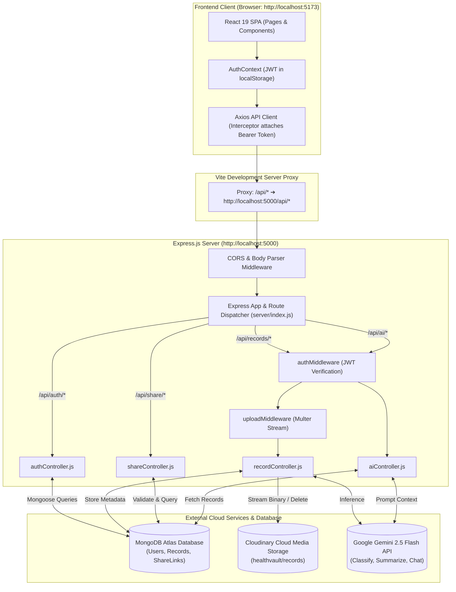
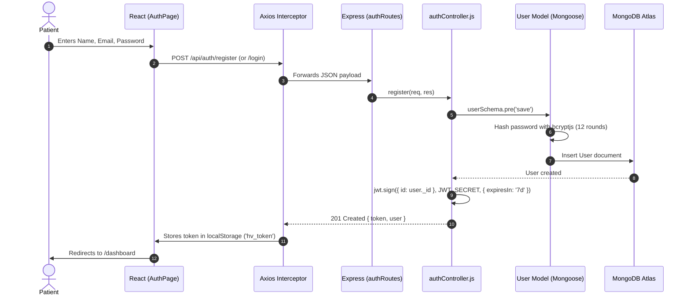
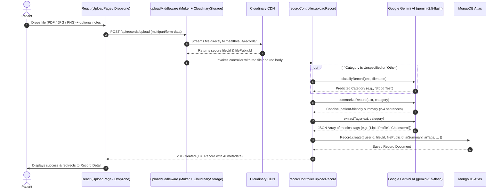
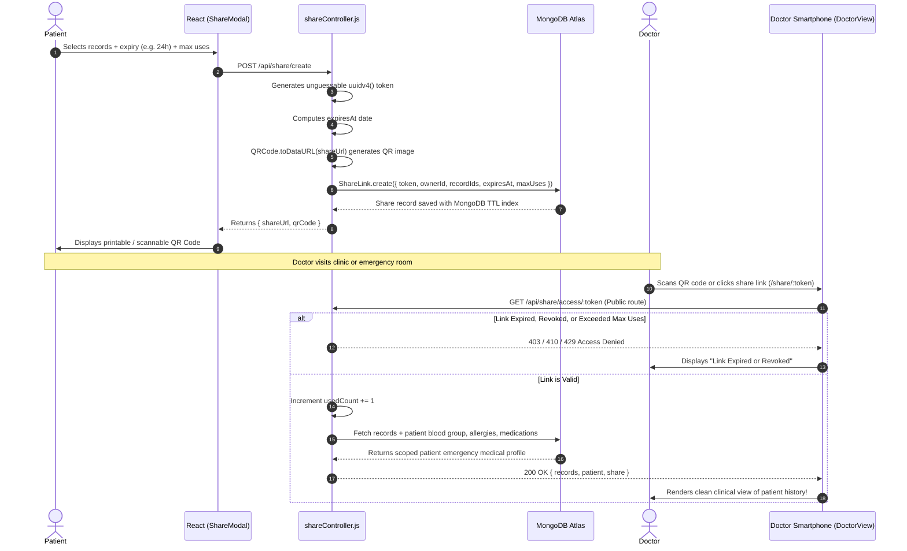
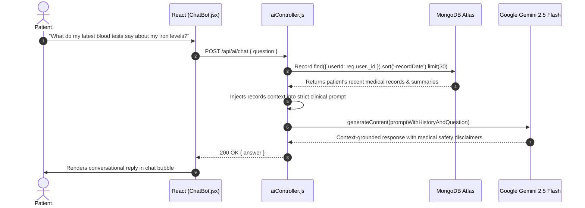
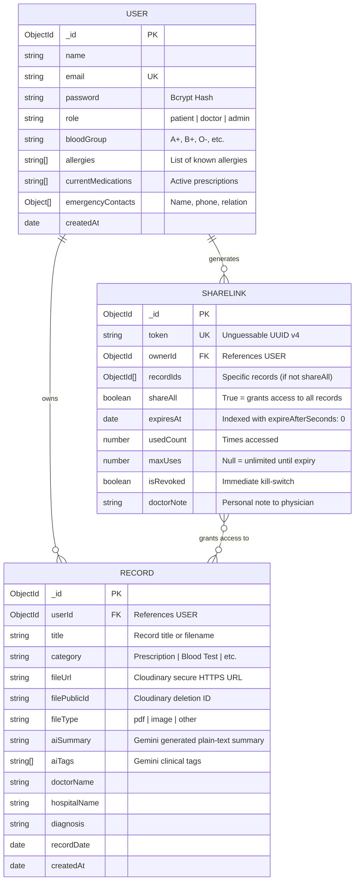

# 🏥 HealthVault — AI-Powered Personal Health Record & Doctor Sharing Platform

> **An end-to-end, privacy-focused medical document management platform built with React 19, Node.js (Native ES Modules), MongoDB Atlas, Cloudinary, and Google Gemini AI.**

---

## 📑 Table of Contents
1. [Project Overview & Philosophy](#-project-overview--philosophy)
2. [Why Are We Using This Stack? (Technology Decisions)](#-why-are-we-using-this-stack-technology-decisions)
   - [Frontend Architecture](#frontend-architecture)
   - [Backend & Database Architecture](#backend--database-architecture)
   - [AI & Media Infrastructure](#ai--media-infrastructure)
3. [System Architecture & Request Lifecycle](#-system-architecture--request-lifecycle)
4. [Where is the Flow Going? (Detailed Workflows)](#-where-is-the-flow-going-detailed-workflows)
   - [Flow 1: User Registration, Authentication & JWT Authorization](#flow-1-user-registration-authentication--jwt-authorization)
   - [Flow 2: Medical Document Upload, Cloud Ingestion & Gemini AI Analysis](#flow-2-medical-document-upload-cloud-ingestion--gemini-ai-analysis)
   - [Flow 3: Doctor Sharing & Time-Limited QR Code Access (Zero-Login)](#flow-3-doctor-sharing--time-limited-qr-code-access-zero-login)
   - [Flow 4: Context-Aware Medical AI Chatbot & Drug Interaction Checker](#flow-4-context-aware-medical-ai-chatbot--drug-interaction-checker)
   - [Flow 5: Emergency Profile & First-Responder View](#flow-5-emergency-profile--first-responder-view)
5. [Database Schema & Entity Relationships](#-database-schema--entity-relationships)
6. [Complete Repository Structure & File Directory](#-complete-repository-structure--file-directory)
7. [Environment Variables & Configuration](#-environment-variables--configuration)
8. [Step-by-Step Installation & Run Guide](#-step-by-step-installation--run-guide)
9. [REST API Endpoint Reference](#-rest-api-endpoint-reference)
10. [Security, Privacy & Compliance Measures](#-security-privacy--compliance-measures)

---

## 💡 Project Overview & Philosophy

Modern healthcare is heavily fragmented. Patients visit multiple clinics, diagnostic laboratories, imaging centers, and hospitals. Their health records end up scattered across physical papers, WhatsApp PDFs, email attachments, and proprietary hospital portals. During emergencies or specialist consultations, critical medical history (blood group, drug allergies, past surgeries, recent prescriptions) is often inaccessible.

**HealthVault solves this problem** by providing:
- A single, encrypted personal health locker in the cloud.
- Automatic document classification, clinical entity extraction, and plain-language summaries powered by **Google Gemini 2.5 Flash**.
- A **Zero-Login QR Code Sharing** engine allowing doctors and emergency responders to view pertinent patient records instantly on any smartphone or tablet without needing an account.
- An interactive **AI Medical Assistant** that answers questions grounded directly in the patient's own medical records.

---

## 🛠️ Why Are We Using This Stack? (Technology Decisions)

Every library and dependency in HealthVault was selected to solve a concrete engineering challenge:

### Frontend Architecture

| Library / Tool | Why are we using this? | What would happen without it? |
|---|---|---|
| **React 19** | Modern component-based declarative UI library with concurrent rendering, high responsiveness, and predictable state updates. | Writing vanilla DOM code would be fragile, slow to develop, and hard to maintain across complex dashboards. |
| **Vite 8** | Modern frontend build tool that serves code via native ES Modules during development for instant Hot Module Replacement (HMR) and bundles with Rollup for fast production builds. | Legacy bundlers like Webpack require minutes of cold-start re-compilation and slow down iterative development. |
| **Tailwind CSS v4** | Utility-first CSS framework with direct `@tailwindcss/vite` compiler integration. Provides design tokens, dark/light themes, and responsive design directly in JSX markup. | Would require hundreds of lines of separate custom CSS files with class-name collisions and bundle bloat. |
| **React Router DOM v7** | Client-side routing engine supporting single-page navigation, URL state, protected route redirects, and tokenized dynamic paths (`/share/:token`). | The browser would perform full-page server reloads on every navigation, wiping out in-memory state. |
| **Axios** | Promise-based HTTP client featuring request & response interceptors. Used to automatically attach `Authorization: Bearer <token>` to outgoing requests and catch 401 Unauthorized errors globally. | Standard `fetch()` requires tedious manual token header injection and manual `response.json()` checks on every call. |
| **Lucide React** | Feather-light, consistent SVG icon set for clean medical indicators (prescriptions, stethoscopes, syringes, shields, search). | Bulky icon fonts or manual SVG files that increase bundle size and look inconsistent. |
| **Framer Motion** | Physics-based animation library used for smooth page transitions, interactive modals, and floating chatbot popups. | Stiff, abrupt UI transitions that make the clinical application feel outdated. |
| **Recharts** | Declarative charting library built on React components and SVG. Powers the visual breakdown of medical records by category (e.g., Blood Tests vs. Prescriptions). | Building custom D3 or canvas charts from scratch requires extensive math and complex SVG lifecycle management. |
| **React Dropzone** | Drag-and-drop file ingestion library with built-in MIME validation, multiple file rejection, and file size limits. | Clunky native `<input type="file">` controls that offer poor UX and no native drag-and-drop feedback. |
| **qrcode.react** | SVG/Canvas QR code generator running in the client to render quick-scan sharing links for doctors on mobile screens. | Patients wouldn't have a visual QR code to show doctors, forcing doctors to manually type 64-character tokens. |
| **React Hot Toast** | Lightweight, animated toast notification engine for upload confirmations, link copying feedback, and error alerts. | Relying on intrusive browser `alert()` popups or writing custom modal alert systems. |

---

### Backend & Database Architecture

| Library / Tool | Why are we using this? | What would happen without it? |
|---|---|---|
| **Node.js (Native ES Modules)** | Modern JavaScript runtime using native `import` and `export` (`"type": "module"`). Delivers asynchronous, non-blocking I/O ideal for handling multiple concurrent file uploads. | CommonJS (`require`) is outdated, causes syntax mismatch with frontend ES modules, and prevents modern tree-shaking. |
| **Express.js** | Lightweight, battle-tested HTTP framework providing middleware composition, routing, and error-handling pipelines. | Writing raw Node HTTP server logic with manual URL parsing, regex routing, and stream handling. |
| **MongoDB Atlas & Mongoose** | Flexible document database. Medical records differ wildly in schema (a blood test has lab values; a prescription has dosages; an MRI has radiological findings). Mongoose enforces model validation and lifecycle hooks. | Rigid relational SQL tables would require complex multi-table joins or messy nullable columns for diverse medical formats. |
| **Bcrypt.js** | One-way cryptographic password hashing using 12 salt rounds before saving to the database. | Storing plain text or weakly hashed passwords exposes patient records to catastrophic credential leaks. |
| **JSON Web Tokens (JWT)** | Stateless authentication tokens signed with a server secret and issued for 7 days. Encodes patient ID and role. | Requiring stateful server-side sessions would force Redis session databases and complicate horizontal scaling. |
| **UUID (v4)** | Cryptographically secure random 128-bit identifier generation for public doctor share links (`/share/<uuid>`). | Using sequential auto-incrementing IDs (e.g., `/share/105`) would allow malicious users to enumerate and steal other patients' records. |

---

### AI & Media Infrastructure

| Library / Tool | Why are we using this? | What would happen without it? |
|---|---|---|
| **Google Gemini AI (`@google/generative-ai`, `gemini-2.5-flash`)** | State-of-the-art, high-speed LLM. Performs 4 key tasks: zero-shot category classification, medical jargon simplification, entity tagging, and patient chatbot queries. | Patients would receive raw, intimidating lab jargon without understanding results; records would remain unsearchable without manual tagging. |
| **Cloudinary & Multer-Storage-Cloudinary** | Cloud media storage with instant CDN delivery and thumbnail transformation. Streams uploaded files directly to Cloudinary without persisting heavy binaries on the server disk. | Saving files to the local server disk would exhaust storage, break horizontal scaling across multiple instances, and crash during high volume. |
| **QRCode (Server-side)** | Generates base64 data URIs of QR codes directly in API responses so both frontend and email/print workflows can embed them immediately. | Limits QR code generation strictly to client-side renders and prevents backend link generation pipelines. |

---

## 🏛️ System Architecture & Request Lifecycle

The diagram below illustrates how client requests traverse the system from React through the Vite reverse proxy, Express middleware, controllers, Cloudinary, Gemini AI, and MongoDB:



---

## 🔄 Where is the Flow Going? (Detailed Workflows)

### Flow 1: User Registration, Authentication & JWT Authorization

This flow secures the application. Every user action is strictly scoped to the authenticated patient's ID.



> [!NOTE]
> **Subsequent Requests**: For every API call made after login, the Axios interceptor in [client/src/services/api.js](file:///E:/HealthVault/client/src/services/api.js) automatically injects the header `Authorization: Bearer <token>`. The backend [server/middleware/authMiddleware.js](file:///E:/HealthVault/server/middleware/authMiddleware.js) extracts this token, verifies it against `JWT_SECRET`, retrieves the user document minus the password, and attaches it to `req.user`.

---

### Flow 2: Medical Document Upload, Cloud Ingestion & Gemini AI Analysis

When a patient uploads a prescription, lab test, or imaging scan, HealthVault handles streaming, storage, classification, and summarization automatically:



---

### Flow 3: Doctor Sharing & Time-Limited QR Code Access (Zero-Login)

This is one of HealthVault's core innovations: **Doctors do not need to register or install an app.** A patient can generate an expiring QR code that grants instant, read-only access to their selected health records:



> [!IMPORTANT]
> **Revocation Control**: The patient can open **My Share Links** on their dashboard and click **Revoke** at any time. This immediately sets `isRevoked: true` in MongoDB, preventing any further doctor access even if the token has not yet reached its expiration timestamp.

---

### Flow 4: Context-Aware Medical AI Chatbot & Drug Interaction Checker

Patients often have questions about their medical records. Rather than searching generic medical forums, HealthVault grounds the conversation in the patient's own history:



---

### Flow 5: Emergency Profile & First-Responder View

In a critical medical situation, doctors need answers in seconds:
- **Blood Type** (e.g., O-Negative, A-Positive)
- **Known Severe Allergies** (e.g., Penicillin, Peanuts, Latex)
- **Active Medications** (e.g., Warfarin, Insulin, Metformin)
- **Emergency Contacts** (Name, relationship, direct phone number)

Patients maintain this profile in [client/src/pages/EmergencyPage.jsx](file:///E:/HealthVault/client/src/pages/EmergencyPage.jsx). When a doctor accesses a shared link, the patient's emergency data is surfaced prominently at the top of the screen before any individual records are viewed.

---

## 🗄️ Database Schema & Entity Relationships

The database is built on MongoDB Atlas using three core schemas:



---

## 📂 Complete Repository Structure & File Directory

```
HealthVault/
├── .gitignore                      # Root git ignore rules (node_modules, .env, dist)
├── README.md                       # Comprehensive system architecture & guide (This file)
│
├── client/                         # FRONTEND SINGLE-PAGE APPLICATION
│   ├── public/                     # Static icons, favicons, and SVG manifests
│   ├── src/
│   │   ├── assets/                 # Brand illustrations and static images
│   │   ├── components/             # Reusable UI modules
│   │   │   ├── ChatBot.jsx         # Floating Gemini AI patient chatbot widget
│   │   │   ├── Navbar.jsx          # Responsive desktop & mobile header
│   │   │   ├── RecordCard.jsx      # Card preview showing category badge, date, tags
│   │   │   └── ShareModal.jsx      # Dialog to configure expiry, max-uses & show QR code
│   │   ├── context/
│   │   │   └── AuthContext.jsx     # Global user session, token storage, login/logout
│   │   ├── pages/                  # Route view components
│   │   │   ├── AuthPage.jsx        # Login & user registration interface
│   │   │   ├── Dashboard.jsx       # Health metrics, quick actions & category chart
│   │   │   ├── DoctorView.jsx      # Public doctor view accessed via QR code link
│   │   │   ├── EmergencyPage.jsx   # Emergency card (blood group, allergies, contacts)
│   │   │   ├── LandingPage.jsx     # Marketing & value-proposition showcase
│   │   │   ├── RecordDetail.jsx    # Full record view, Gemini AI summary, actions
│   │   │   ├── RecordsPage.jsx     # Filterable list with category tabs & search
│   │   │   ├── TimelinePage.jsx    # Visual chronological history of medical events
│   │   │   └── UploadPage.jsx      # Drag-and-drop document upload with AI tagging
│   │   ├── services/
│   │   │   └── api.js              # Axios instance configured with JWT interceptor
│   │   ├── App.jsx                 # Route definitions and layout wrapper
│   │   ├── index.css               # Tailwind CSS v4 directives and root typography
│   │   └── main.jsx                # React 19 application root entrypoint
│   ├── package.json                # Frontend dependencies and dev scripts
│   ├── vite.config.js              # Vite server setup + reverse proxy to :5000
│   └── README.md                   # Client-specific quick reference
│
└── server/                         # BACKEND REST API (NATIVE ES MODULES)
    ├── controllers/                # Request handlers & application logic
    │   ├── aiController.js         # Gemini chatbot, timeline & drug-check handlers
    │   ├── authController.js       # Register, login, profile & JWT token issuance
    │   ├── recordController.js     # CRUD operations for records & AI re-summarization
    │   └── shareController.js      # Share link generation, QR codes & doctor access
    ├── middleware/                 # Route guards & pipelines
    │   ├── authMiddleware.js       # JWT extraction & user verification guard
    │   └── uploadMiddleware.js     # Multer & Cloudinary direct stream configuration
    ├── models/                     # Mongoose schemas & data validations
    │   ├── Record.js               # Medical record schema with text search indexes
    │   ├── ShareLink.js            # Tokenized link schema with MongoDB TTL expiration
    │   └── User.js                 # Patient profile schema with bcrypt password hashing
    ├── routes/                     # Express router definitions
    │   ├── aiRoutes.js             # Endpoints for Gemini AI features
    │   ├── authRoutes.js           # Endpoints for authentication & profile
    │   ├── doctorRoutes.js         # Placeholder / doctor portal routes
    │   ├── recordRoutes.js         # Endpoints for uploading & managing records
    │   └── shareRoutes.js          # Endpoints for creating & consuming share links
    ├── utils/                      # Helper libraries
    │   └── gemini.js               # Google Generative AI SDK prompt pipelines
    ├── .env                        # Private environment variables (DO NOT COMMIT)
    ├── .env.example                # Template for environment configuration
    ├── .gitignore                  # Ignores server node_modules and .env
    ├── index.js                    # Express application entrypoint & Mongo connection
    └── package.json                # Backend dependencies ("type": "module")
```

---

## ⚙️ Environment Variables & Configuration

### 1. Frontend Configuration (`client/.env`)
Copy the template from [client/.env.example](file:///E:/HealthVault/client/.env.example):
```bash
cp client/.env.example client/.env
```

| Variable | Example Value | Description |
|---|---|---|
| `VITE_API_URL` | `https://healthvault-backend-ydqk.onrender.com` | Base URL of the backend API (use `http://localhost:5000` for local dev). |

### 2. Backend Configuration (`server/.env`)
Copy the template from [server/.env.example](file:///E:/HealthVault/server/.env.example):
```bash
cp server/.env.example server/.env
```

| Variable | Example Value | Description |
|---|---|---|
| `PORT` | `5000` | Port number on which Express listens (Render sets automatically). |
| `CLIENT_URL` | `https://your-frontend.vercel.app` | Allowed frontend origin(s) for CORS & QR share links (comma-separated if multiple). |
| `MONGO_URI` | `mongodb+srv://...` | Connection URI for MongoDB Atlas cluster. |
| `JWT_SECRET` | `your_secret_key` | Cryptographic secret used to sign and verify patient authentication tokens. |
| `CLOUDINARY_CLOUD_NAME` | `your_cloud_name` | Cloudinary account name where medical files and scans are hosted. |
| `CLOUDINARY_API_KEY` | `1234567890` | Cloudinary API Key for authenticated file uploads and deletions. |
| `CLOUDINARY_API_SECRET` | `abcde_xyz...` | Cloudinary API Secret for authenticated uploads. |
| `GEMINI_API_KEY` | `AIzaSy...` | Google AI Studio API key used to invoke `gemini-2.5-flash`. |

---

## 🚀 Step-by-Step Installation & Run Guide

### 1. Prerequisites
- **Node.js**: Version 18.0.0 or higher (`node -v` to verify).
- **MongoDB**: Active MongoDB database (local or free cloud tier on [MongoDB Atlas](https://www.mongodb.com/cloud/atlas)).
- **Cloudinary**: Free account from [Cloudinary](https://cloudinary.com/) (provides Cloud Name, API Key, API Secret).
- **Google Gemini**: Free API key from [Google AI Studio](https://aistudio.google.com/).

### 2. Configure Backend
```bash
cd server
npm install
# Create .env and populate your secrets
cp .env.example .env
```

Start the backend in development mode (with auto-reload):
```bash
npm run dev
```
> Server will log:
> ```
> ✅ MongoDB connected
> 🚀 Server running on port 5000
> ```

### 3. Configure Frontend
Open a second terminal window:
```bash
cd client
npm install
npm run dev
```
> Client will log:
> ```
> VITE v8.0.3  ready in 250 ms
> ➜  Local:   http://localhost:5173/
> ```

### 4. Open in Browser
Visit **[http://localhost:5173](http://localhost:5173)** to register a patient account and upload your first medical document!

---

## 📡 REST API Endpoint Reference

### 🔐 Authentication (`/api/auth`)
- `POST /api/auth/register` — Register a new account (`{ name, email, password, role }`). Returns JWT token and user profile.
- `POST /api/auth/login` — Authenticate existing user (`{ email, password }`). Returns JWT token and user profile.
- `GET /api/auth/me` *(Protected)* — Retrieve current user's authenticated profile.
- `PUT /api/auth/profile` *(Protected)* — Update medical details (`{ bloodGroup, allergies, currentMedications, emergencyContacts }`).

### 📑 Medical Records (`/api/records`)
- `GET /api/records` *(Protected)* — List records. Supports query parameters `?category=Blood+Test`, `?search=glucose`, `?page=1`, `?limit=20`.
- `POST /api/records/upload` *(Protected)* — Upload medical file (`multipart/form-data` with `file`, optional `title`, `category`, `doctorName`, `recordDate`).
- `GET /api/records/stats` *(Protected)* — Aggregate count by category and recent records for dashboard charts.
- `GET /api/records/:id` *(Protected)* — Fetch complete details of a single record.
- `PUT /api/records/:id` *(Protected)* — Edit record metadata.
- `DELETE /api/records/:id` *(Protected)* — Delete record from MongoDB and delete asset from Cloudinary CDN.
- `POST /api/records/:id/regenerate-ai` *(Protected)* — Re-run Gemini AI to generate new plain-language summaries and tags.

### 🔗 Sharing & QR Code Engine (`/api/share`)
- `POST /api/share/create` *(Protected)* — Create a time-limited share link (`{ recordIds, shareAll, expiresInHours, maxUses, doctorNote }`). Returns URL and base64 QR code image.
- `GET /api/share/my-links` *(Protected)* — List all share links created by the user with view counts and status.
- `PATCH /api/share/:id/revoke` *(Protected)* — Immediately revoke an active share link.
- `GET /api/share/access/:token` *(Public)* — Doctor / Emergency view. Validates token expiry, increments view count, and returns authorized records and emergency profile.

### 🧠 Gemini AI Intelligence (`/api/ai`)
- `GET /api/ai/insight` *(Protected)* — Computes health journey insights across recent medical records.
- `POST /api/ai/chat` *(Protected)* — Ask clinical questions grounded in patient's stored records (`{ question }`).
- `POST /api/ai/drug-check` *(Protected)* — Check interactions across a list of active medications (`{ medications: [...] }`).
- `GET /api/ai/timeline` *(Protected)* — Chronological history of medical visits and diagnoses.

### 🩺 System & Diagnostics
- `GET /api/health` — Returns API operational status and timestamp.
- `GET /api/doctor/ping` — Doctor route health check.

---

## 🛡️ Security, Privacy & Compliance Measures

1. **Strict User Scoping**: All database queries for records (`find`, `findOne`, `findOneAndUpdate`, `deleteOne`) enforce `{ userId: req.user._id }`. A malicious user cannot view or mutate another patient's documents by tampering with IDs.
2. **Cryptographic Link Tokens**: Share links use non-deterministic `uuidv4()` tokens with 122 bits of entropy, making brute-force URL scanning practically impossible.
3. **Automatic Data Expiration (TTL)**: MongoDB's native Time-To-Live indexes automatically clean up expired share link documents from the database without requiring manual cron jobs.
4. **Credential Isolation**: User passwords are encrypted with bcrypt before persistence and are explicitly excluded from API queries via Mongoose `.select('-password')`.
5. **CORS Isolation**: The Express API restricts cross-origin resource access exclusively to the specified `CLIENT_URL`.
6. **MIME & Size Validation**: Uploaded files are strictly validated against an allowed MIME whitelist (`image/jpeg`, `image/png`, `image/webp`, `application/pdf`) and capped at 20MB to prevent storage denial-of-service.

---

## 📄 License

Distributed under the MIT License. See `LICENSE` for more information.
